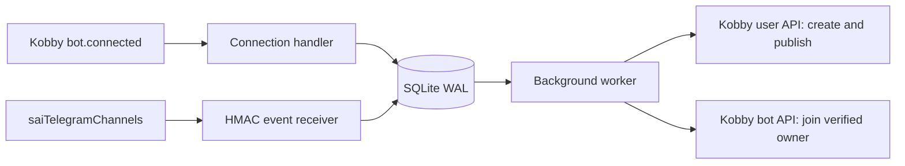

# Architecture and protocol decisions

## Components

Python, FastAPI, one Uvicorn process, one background worker, SQLite WAL with
`synchronous=FULL`, and an exclusive process lock form the first release. The
database and encryption key are mounted separately. Credentials are encrypted
with Fernet, including subscriber tokens, HMAC secrets, the publisher password,
and its current session. Public post text and identifiers remain readable in the
database. Back up and restrict access to both the database and the key.

## Trusted connection exchange

`POST /t.me/{username}` starts onboarding for Kobby `bot.connected` events. The service
checks timestamp, structural identifiers, and event/header consistency, persists
an `exchange_id`, and calls `/api/v1/bot/connect` on the configured origin.
Credentials from that exchange authenticate the original raw webhook via HMAC.
Owner, bot, event, permissions, chat scope, and `/bot/me` must agree before any
business action. Neither a URL path nor an unverified owner field grants admin
authority. API clients reject redirects and do not use environment proxies.

`communities.join` must be present at connection and join time. Additional
permissions, selected chats, and access to all personal chats do not prevent
connection. Subscriber tokens are used only for identity checks and joining.
Incoming `message.created` webhooks are checked against the stored bot, owner,
source path, timestamp, and HMAC, then acknowledged without saving their contents
or making chat API calls. This prevents unused chat access from causing delivery
errors. Unknown event types remain unsupported.

The business job persists its progress. The handler returns a retryable response
until the worker confirms Kobby membership, then acknowledges the webhook. This
preserves the meaning of Kobby's connected status. Rotation creates another
connection event but leaves the source registry and publication IDs intact.
Stale events cannot replace newer credentials because `/bot/me` verifies the
candidate token against Kobby's current state.

## Registry and source initialization

One database is bound to one Kobby and watcher origin. `sources.id` is the positive
Telegram channel ID, not the username or title. Source initialization resolves
the username through the watcher and checks its status and retained history.
The initial high-water mark, random Kobby channel ID, and exact creation body are
committed before creating the channel. API timeouts reuse that body and ID.

The watcher webhook has one fixed callback URL per source:
`/events/telegram/{channel_id}`. Repeating registration recovers the same webhook
secret. Events arriving before the secret is saved receive 503 and are retried.
A poll reconciles the registration gap within the upstream five-post window.
New subscribers do not reset the source baseline or import historical posts.

Known upstream constraints include stale username metadata after a Telegram
rename, five-post retention, mutable payloads on retries after edits, and no
general history/replay API. A new username resolving to the same channel ID
still reuses the existing mirror. Complete rename/link refresh should be added
to the watcher; a prepared publication must never be rewritten during a retry.

## Storage

| Table | Purpose |
|---|---|
| `settings` | Bind the database to trusted service origins |
| `secrets` | Encrypted publisher account and watcher API key |
| `exchanges` | Durable exchange claim and verified credentials per event |
| `connections` | Current subscriber bot, owner, source, join state and retries |
| `sources` | Stable source ID, baseline, cursor, mirror ID and creation request |
| `posts` | First accepted snapshot, unique by source and message ID |
| `inbox` | Webhook event identity deduplication |
| `outbox` | Immutable prepared request per source, message and part |

Post snapshot, deduplication entry, publication requests, and cursor update commit
together. Events are acknowledged only after commit. Polling revisits the retained
window above the original baseline, so a later webhook does not hide an earlier
out-of-order message. A source cursor is an observation watermark, not proof that
all Telegram history has been recovered.

## Publication and failures

`POST /api/v1/messages` uses the publisher's user session with the mirror chat ID,
`recipient_id=community:<id>`, plain UTF-8 text encoded in standard base64, and a
stable ID derived from server, source, message ID, and part number. The full request
is saved before sending. An identical server duplicate completes the same job.
Each source sends its earliest known unfinished part before later queued parts.

Network/5xx errors use backoff; 429 respects `Retry-After`. Publisher 401 triggers
password login, validates the returned identity, and repeats the original request.
If login fails, publications stay pending. Persistent validation/conflict failures
remain visible and block subsequent parts for that source. A missing/deleted
mirror or lost publishing permission never causes automatic replacement.

Subscriber bot permissions are checked at connection/join time. Once joined,
normal Kobby membership controls reading and notifications. Disabling the bot does
not remove existing membership; users unsubscribe by leaving the channel in Kobby.

Kobby currently limits communities to 500 members (including the owner), and
creation/join checks the 500-current-chat threshold. Errors are surfaced instead
of making another mirror. Multiple independent Kobby writer replicas are outside
the current upstream idempotency guarantees.

## Verified upstream contracts

- Kobby commit `b19915c2a0067ec732b770f6c5b112798e16021e`:
  `docs/BOT_DEVELOPMENT.md`, `docs/BOTS.md`, `docs/BOT_CONNECTION.md`, the
  `connect-contact-bot` example, and server auth/community/message handlers.
- saiTelegramChannels commit `3f01c6f3217246fb67761703da840aa4a7349710`:
  README, API, Telegram watcher, store, and webhook sender implementation.

No messenger publication API extension is required.
